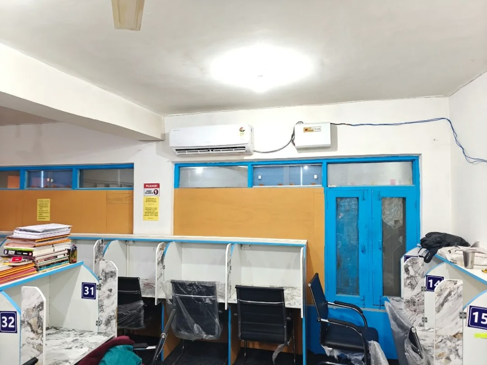
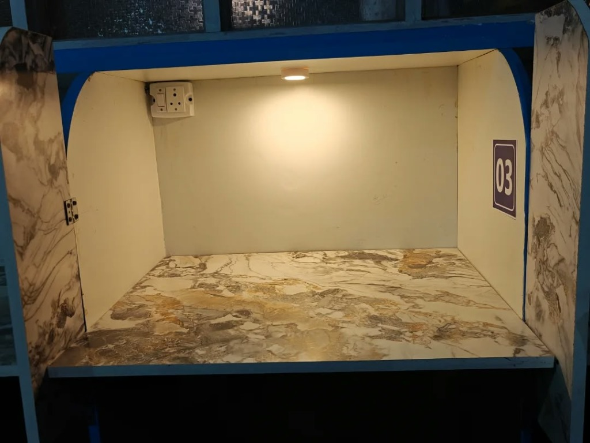
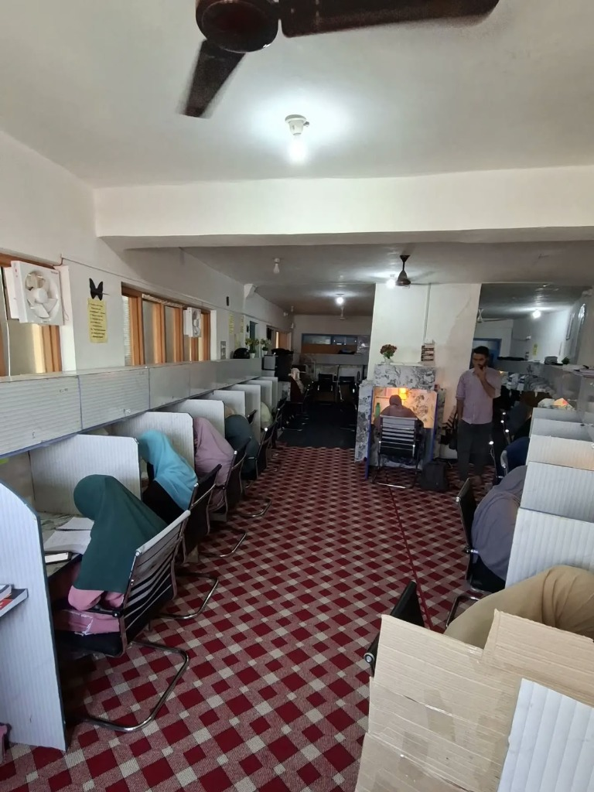
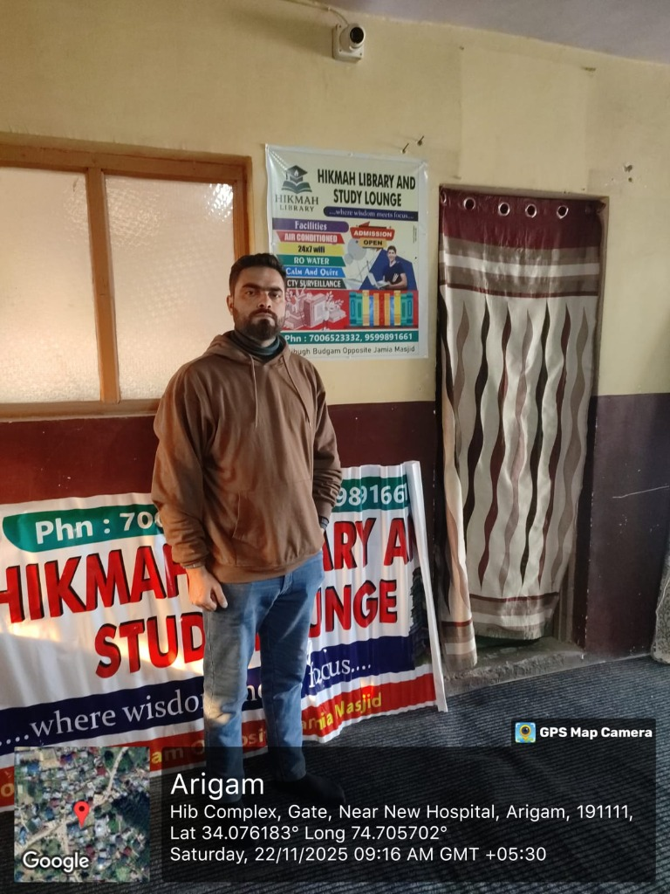

<div align="center">

# 📖 Hikmah Library & Study Lounge
### *Where Wisdom Meets Focus*

[](https://hikmah-library.vercel.app)
[](https://react.dev/)
[](https://www.typescriptlang.org/)
[](https://vitejs.dev/)
[](https://github.com/syedabsar99/hikmah-library/actions)

<p align="center">
  A state-of-the-art, 24/7 academic sanctuary and comprehensive library management platform engineered for competitive exam aspirants, medical scholars, civil service candidates, and university researchers.
</p>

[**Explore Live Website ↗**](https://hikmah-library.vercel.app) &nbsp;•&nbsp; [**Key Features**](#-key-features) &nbsp;•&nbsp; [**System Architecture**](#-system-architecture) &nbsp;•&nbsp; [**Setup Guide**](#-setup--deployment) &nbsp;•&nbsp; [**Facility Showcase**](#-campus--study-environment)

---

</div>

## 📸 Campus & Study Environment

<div align="center">
  <table>
    <tr>
      <td width="50%" align="center">
        
        <br />
        <em><strong>Climate-Controlled Study Hall</strong> — Ergonomic workstations with dual-season AC</em>
      </td>
      <td width="50%" align="center">
        
        <br />
        <em><strong>Dedicated Private Study Cabins</strong> — Individual reading lights, power sockets & lockers</em>
      </td>
    </tr>
    <tr>
      <td width="50%" align="center">
        
        <br />
        <em><strong>Disciplined Silent Focus Corridor</strong> — Soundproofed, zero-distraction sanctuary</em>
      </td>
      <td width="50%" align="center">
        
        <br />
        <em><strong>Campus Reception & Lounge</strong> — Hib Complex, Near New Hospital, Soibugh, Budgam</em>
      </td>
    </tr>
  </table>
</div>

---

## 🌟 Key Features

### 🕒 1. 24/7 Round-the-Clock Academic Access (Zero-Shift Policy)
* **No Rigid Shifts:** Traditional morning/evening shifts are eliminated. Enrolled members enjoy 24/7 continuous access.
* **Dedicated Workstation Ownership:** Every student is assigned a dedicated desk or private cabin reserved exclusively for them.

### 🛡️ 2. Autonomous Administrative Authority Succession
* **Email-Verified Handover:** Complete administrative succession with two-factor email verification.
* **Global Dynamic Contact Propagation:** When authority is transferred to a new administrator, contact helplines, WhatsApp links, and official email addresses across the entire website update in real time without touching source code.

### 📱 3. Fee & Expiry Tracker with One-Click WhatsApp Dispatch
* **Automated Renewal Calendars:** Due dates automatically advance upon payment clearance.
* **Direct WhatsApp Integration:** Automated WhatsApp reminder generator for due/overdue students with custom respectful messaging templates.
* **Settlement Safeguard:** Reminders are strictly suppressed for members who have already settled dues.

### ⚖️ 4. 10-Point Disciplinary Meter & Warning Governance
* **Transparent Code of Conduct:** Systematic 10-step disciplinary warning tracking for silence infractions, mobile phone disturbances, or property misuse.
* **Audited Warning Corrections:** Complete audit trail of administrative citations, preventing arbitrary penalties.

### 🎓 5. Student Self-Service Portal
* **Personalized Dashboard:** Live desk allocation, attendance records, fee status, and official announcements.
* **Responsive Mobile Experience:** Built from the ground up for full smartphone usability with optimized touch targets.

### 🔒 6. Zero-Backdoor Security Architecture
* **No Hardcoded Passwords:** No default production passwords shipped in source code. Secure initial master provisioning initializes administrative access.
* **Zero Backdoor Pins:** Student access strictly validates against configured credentials; trivial pins (`1234`, `Member@123`) and phone number suffix fallbacks are permanently rejected.
* **Single-Use Verification Tokens:** Cryptographic tokens with strict 15-minute expirations and SHA-256 validation.
* **Role-Based Isolation:** Complete boundary enforcement between student records and administration consoles.
* **Anti-Enumeration Protection:** Sanitized authentication responses to safeguard student and faculty privacy.

---

## 🏗️ System Architecture

```
hikmah-library/
├── .github/workflows/        # Automated 24/7 GitHub Actions CI/CD pipeline
├── public/                   # Static assets, gallery photographs, 404 SPA fallback
│   ├── images/gallery/       # Authentic campus photography
│   ├── 404.html              # GitHub Pages deep-routing handler
│   └── _redirects            # SPA redirect rule for Netlify / Cloudflare
├── src/
│   ├── components/           # Navbar, Footer, Modals, OTP verification widgets
│   ├── context/              # AuthContext with dynamic contact propagation
│   ├── pages/
│   │   ├── PublicHome.tsx    # Showcase landing page, photo gallery, rules
│   │   ├── AdminDashboard.tsx# 10-tab administrative management console
│   │   ├── MemberPortal.tsx  # Self-service student academic portal
│   │   ├── AdminLogin.tsx    # Administrator authentication console
│   │   ├── MemberLogin.tsx   # Student directory authentication
│   │   └── ResetPassword.tsx # Secure single-use password recovery
│   ├── services/             # DataService, real email dispatcher, OTP service
│   └── index.css             # High-contrast, glassmorphic design system
├── tests/                    # 18 automated test suites (156 test cases)
└── vite.config.ts            # Vite configuration with relative assets & API bridge
```

---

## 🚀 Setup & Deployment

### Local Development Setup
1. Clone the repository:
   ```bash
   git clone https://github.com/syedabsar99/hikmah-library.git
   cd hikmah-library
   ```
2. Install dependencies:
   ```bash
   npm install
   ```
3. Start the local development server:
   ```bash
   npm run dev
   ```
4. Run verification tests:
   ```bash
   npm test
   ```

### Optional: Cloud Firebase Integration
To sync with Firebase Cloud Firestore & Firebase Auth:
1. Copy `.env.example` to `.env`:
   ```bash
   cp .env.example .env
   ```
2. Enter your Firebase Spark plan project keys in `.env`.
3. If `.env` is omitted, the application automatically runs in High-Performance Local Persistent Mode!

### Deployment to GitHub Pages
The repository includes a ready-to-run GitHub Actions workflow (`.github/workflows/deploy.yml`). Pushing commits to `main` automatically builds and publishes the production site to GitHub Pages with zero server costs.

---

## 🧪 Quality Assurance & Testing

The application includes an automated test suite verifying role authorization, fee calculations, disciplinary warnings, zero-backdoor authentication, and password recovery workflows.

```bash
# Execute complete verification test suite
npm test
```

```
------------------------------------------------------
TOTAL TESTS: 156 | PASSED: 156 | FAILED: 0
------------------------------------------------------
```

---

## 🏛️ Institution Details

* **Institution:** Hikmah Library & Study Lounge
* **Location:** Hib Complex, Near New Hospital, Opp. Jamia Masjid, Soibugh, Budgam (PIN: 191111)
* **Operating Hours:** 24 Hours / 7 Days a Week (Round-the-clock dedicated access)

---

<div align="center">
  <sub>Designed &amp; Engineered by Syed • Built for Hikmah Library &amp; Study Lounge</sub>
</div>
